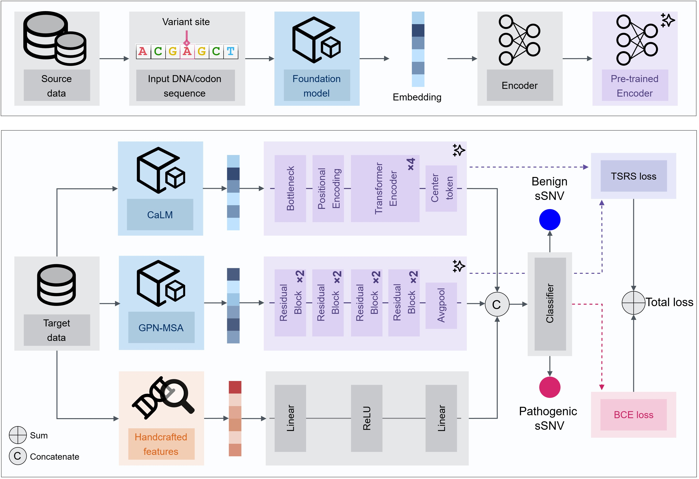
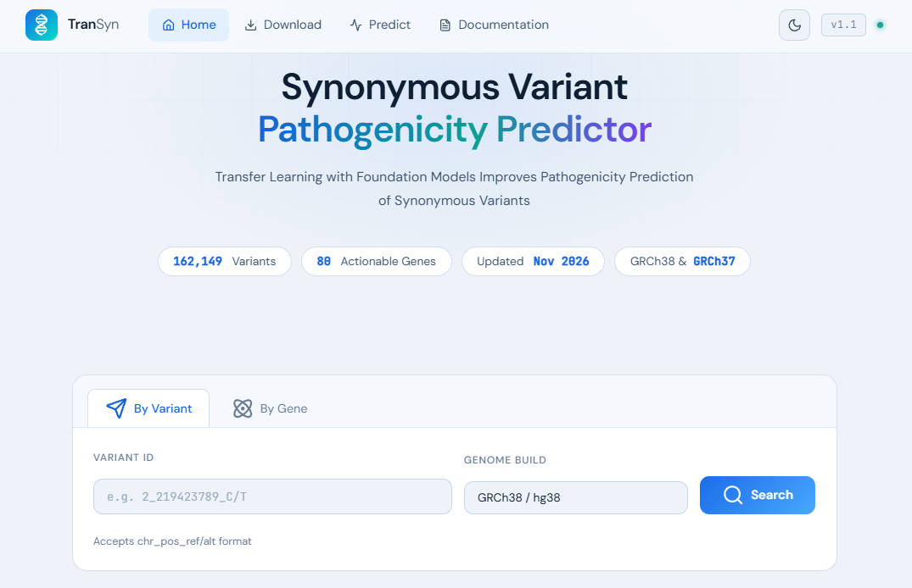

# TranSyn

> 💻 **Computational method:** TranSyn is a transfer-learning framework for prioritizing potentially deleterious synonymous single-nucleotide variants. This reposority covers input validation, source-domain preprocessing, feature extraction, inference, evaluation, and related analyses in the manuscript. 



> 🌐 **Online web server:** Precomputed genome-wide scores for actionable genes, as well as online prediction, are available at the [TranSyn web server](https://bioinfo.ahu.edu.cn/transyn).



# Scope and supported inputs

- Genome assembly: GRCh38/hg38 only (inference function); coordinates are one-based.
- Variant type: biallelic synonymous SNVs with `A/C/G/T` REF and ALT alleles.
- Chromosomes: 1–22, X, and Y.
- Required columns: `#CHROM`, `POS`, `REF`, and `ALT` in a **tab-separated** file.
- Unsupported: indels, multi-allelic rows, symbolic/non-ACGT alleles, duplicate
  rows, other assemblies, and reference-allele mismatches.

> 🏥 **Usage note:** TranSyn is a computational prioritization model. Its score is NOT a clinical classification and should NOT be used as the sole basis for patient decisions.

# Installation and external models

> 🔧 **Prerequisite:** Inference additionally requires independently installed `GPN-MSA` and `CaLM` environments, please confirm the corresponding enviroments and model weights have been satisfied.

- GPN-MSA: https://github.com/songlab-cal/gpn
- CaLM: https://github.com/oxpig/CaLM

Prepare the environment for TranSyn:

```bash
conda env create -f environment.yml
conda activate transyn
```

Recommended hardware requiement:
- Linux workstation with 16 GB RAM
- NVIDIA GPU with at least 12 GB VRAM

# Complete prediction workflow

1. **Input preparation:** prepare a GRCh38/hg38 TSV and validate its alleles against the same GRCh38 FASTA used by the feature extractors.
2. **Feature extraction:** generate biological, GPN-MSA, and CaLM features in their configured environments.
3. **Impute and scale:** impute biological missing values, and apply the scaler.
4. **Merge and predict:** merge modalities by `Variant38` (variant identifier in hg38, format: `chromosome_position_reference allele_alternate allele`), predict, and inspect skipped records.
5. **Interpret:** the `TranSyn_score` evaluates the probability of the deleterious class, with larger values indicate higher likelihood to be pathogenic.

One-command evaluation:

```bash
bash scripts/run_evaluation.sh \
  example/input.grch38.tsv /path/to/GRCh38.fa local.pipeline.yaml \
  model_weight/model.pt config/config.yaml work/example
```

A successful run prints `PASS: 1 unique GRCh38 biallelic SNVs` and produces `work/example/predictions.tsv` with the schema shown in `example/expected_output.tsv`.

# Quality control and troubleshooting

| Check or symptom | Expected action |
|---|---|
| REF does not match FASTA | Confirm GRCh38, contig naming, and one-based POS|
| Variant is absent from output | Inspect `features.pth.skipped.tsv` for a missing GPN-MSA / CaLM / biological representation. |
| Biological feature columns differ | Use the released `header.selected.info`; column order is part of the model. |
| Score changes between machines | Check model/scaler checksums, package versions, device precision, and external-model versions. |
| CUDA out of memory | Reduce `--batch-size`; run each foundation model in its own environment/process. |
| Empty output | Confirm input QC passed and every external stage produced a non-empty configured output. |


# Licensed data and preprocessing

1. HGMD datasets are not included. Users with access can reproduce noncoding or missense source-domain preparation with `preprocess/prepare_source_domains.py`; see `preprocess/README.md`.

2. Random seeds for results reproduction are explicit.

3. History log and hyperparameter searching script using optuna are provided in `./optuna`.

# Manuscript figures and additional analyses

- Figure 2: train/evaluate with `main.py`, then run `Result-section-II.ipynb`.
- Figure 3: run `main.py`, `layer_wise.py`, and the two Section III notebooks: `Result-section-III-NearBy-Source.ipynb` and `Result-section-III.ipynb`.
- Figure 4: run `pretrain.py`, `finetune.py`, `ablation.py`, `zeroshot.py`, and
  `Result-section-IV.ipynb`.
- Figure 5: run `Result-section-V.ipynb` using the released inference output.
- Domain-composition and label-shuffle controls are under `additional_analysis/`;
  each subdirectory documents its inputs and outputs.

# Output interpretation

The `predictions.tsv` file contains:

- `Variant38`: `CHROM_POS_REF/ALT` on GRCh38.
- `TranSyn_score`: float, deleterious-class probability in `[0, 1]`.


# Citation and contact

> In preparation.